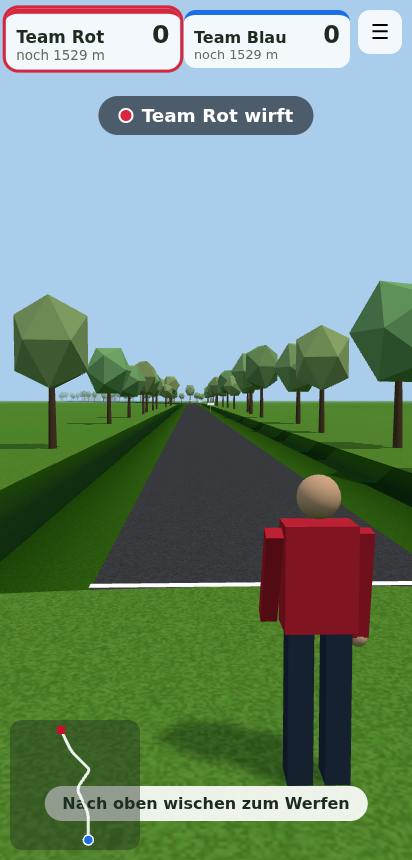
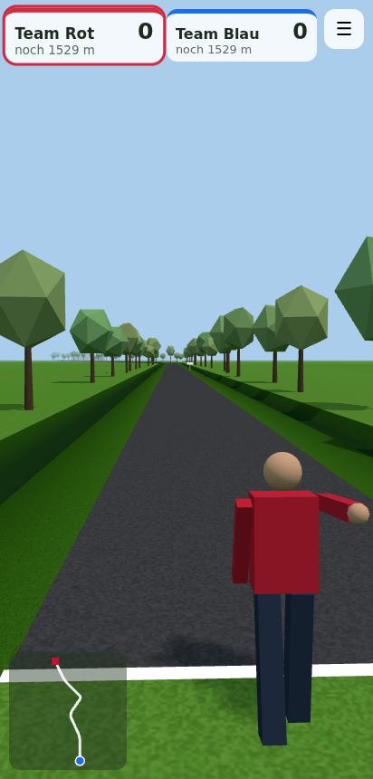

<div align="center">

# Boßel-Simulator

**Boßeln on real roads – pick any route from OpenStreetMap and play it in 3D.**

[](https://github.com/aikitori/bosel-simulator/actions/workflows/android.yml)
[](https://github.com/aikitori/bosel-simulator/releases/latest)

[**Download APK**](https://github.com/aikitori/bosel-simulator/releases/latest/download/bosel-simulator.apk) · [**Play in the browser**](https://aikitori.github.io/bosel-simulator/)

 

</div>

## Features

- **Real routes:** tap start and finish on the map, extra taps add detours. The route follows OSM roads, with road width, surface (asphalt, clinker, gravel) and nearby buildings.
- **3D thrower view:** run-up, underhand throw, the camera chases the ball.
- **Physics:** the ball bounces, rolls, drifts to the road edge and runs straight on in bends – right into the ditch.
- **Two teams on one device:** take turns or play the traditional way (whoever is behind throws). Optional player names per team.
- **Offline practice course** and saved routes.

## How to play

1. Put your finger on the screen and flick upwards – the faster, the farther.
2. Flick at an angle to aim. Mind the bends!
3. If the ball ends up in the ditch, play continues where it left the road.
4. The team that reaches the finish with fewer throws wins. Tap to fast-forward a throw.

## Development

```
src/
  osm/     Overpass queries, routing (Dijkstra), course model, demo course
  game/    physics, rules, Three.js scene, swipe input, HUD
  map/     Leaflet route picker
test/      Vitest tests (physics, rules, routing on OSM sample data)
android/   Capacitor Android project
```

```sh
npm install
npm run dev        # http://localhost:5173
npm test
npm run build
npm run android:sync
```

Every push to `main` builds a signed APK release and the web version (GitHub Pages).

Map data © [OpenStreetMap](https://www.openstreetmap.org/copyright) contributors.
